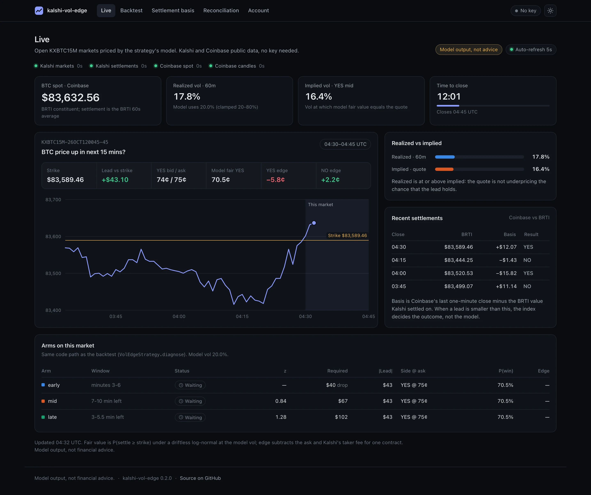
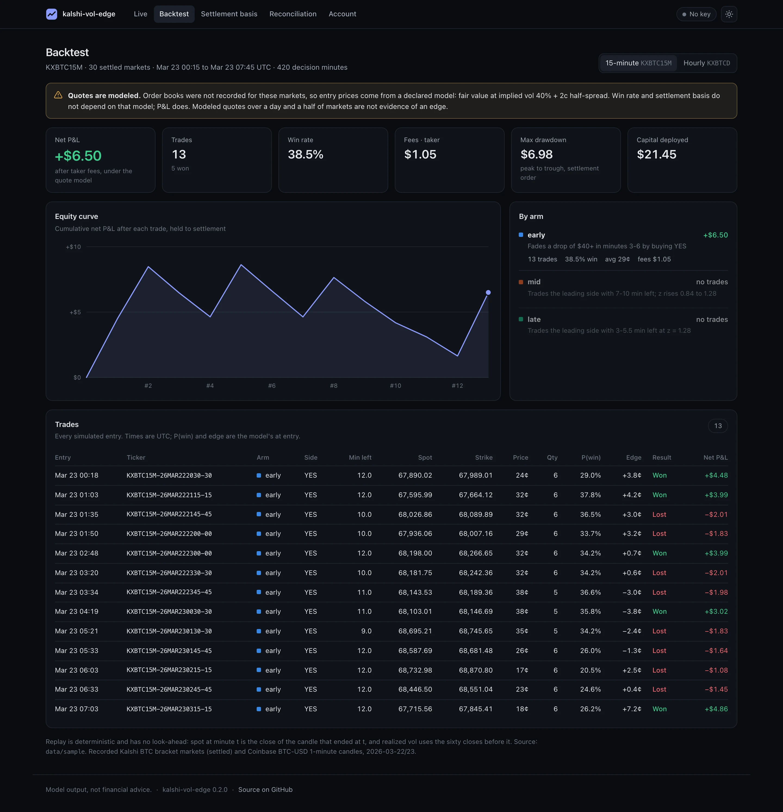
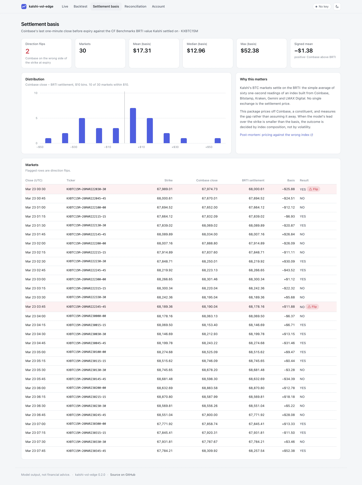
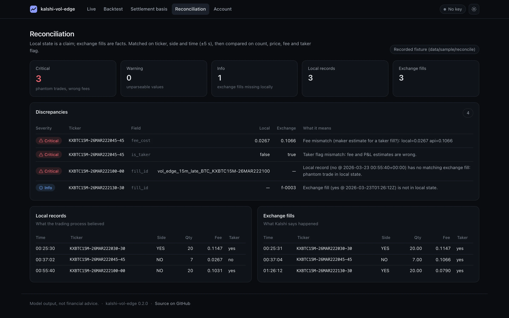
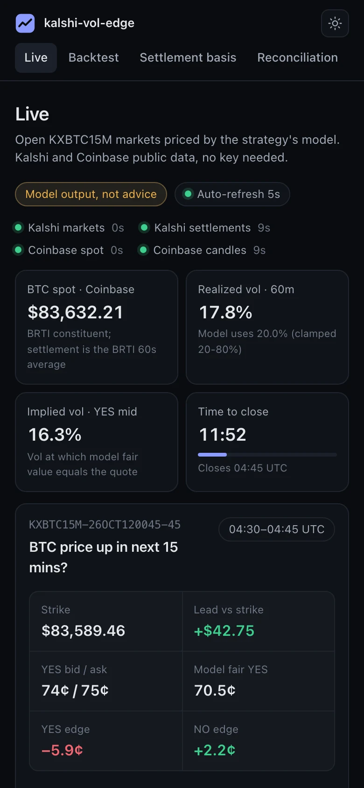

# kalshi-vol-edge

A trading terminal and backtester for Kalshi's 15-minute BTC contracts. It is built around the parts that are easy to get wrong: which index actually settles the contract, what the exchange says happened versus what your database thinks happened, and what fees really cost.

[](https://github.com/Nadimul96/kalshi-vol-edge/actions/workflows/ci.yml)




**[Open the static report](https://nadimul96.github.io/kalshi-vol-edge/)** (backtest, settlement basis, reconciliation; no install) · **[Post-mortems](#post-mortems)**

> **Not financial advice.** The live version of this system traded real money for about seven months and ended with a small net loss. Everything the dashboard shows is model output. The [post-mortems](#post-mortems) explain what the data showed.

## Why it's interesting

- **Settlement-aware pricing.** Kalshi BTC settles on the CF Benchmarks BRTI, a 60-second average across five exchanges. The feed is Coinbase, a constituent, and every backtest, the static report and the live page measure the Coinbase-vs-BRTI basis instead of assuming it is zero. In the sample, 2 of 30 markets settled on the other side of the strike from Coinbase. [`data/prices.py`](src/kalshi_vol_edge/data/prices.py), [`web/live.py`](src/kalshi_vol_edge/web/live.py)
- **One strategy code path, everywhere.** `VolEdgeStrategy.diagnose` returns each arm's z-score, required lead, win probability, edge and the reason it does or does not fire. The backtest's `evaluate` and the live dashboard both use it, so the UI can never disagree with the replay. [`strategy/vol_edge.py`](src/kalshi_vol_edge/strategy/vol_edge.py)
- **Exchange as source of truth.** Local orders are claims; exchange fills are facts. Reconciliation matches each recorded order to its fills by `client_order_id`, then exchange order id, sums partial fills, and catches phantom orders, fills that happened after a crash, and fees recorded as maker that were charged as taker. The dashboard reconciles live against a SQLite file opened in read-only mode. [`kalshi/reconcile.py`](src/kalshi_vol_edge/kalshi/reconcile.py), [`kalshi/truth.py`](src/kalshi_vol_edge/kalshi/truth.py), [`storage/sqlite.py`](src/kalshi_vol_edge/storage/sqlite.py)
- **Loud-failure, deterministic backtest.** No silent fallback to synthetic data, no look-ahead, no randomness. Quotes that were not recorded are declared as modeled, and the report says so at the top. [`backtest/engine.py`](src/kalshi_vol_edge/backtest/engine.py)
- **A dashboard with no frontend build.** FastAPI renders Jinja templates; about 130 lines of vanilla JS poll an HTML fragment and add chart hover. Charts are hand-made SVG computed in Python and unit-tested. The same templates render the static report. [`web/`](src/kalshi_vol_edge/web)

## Quickstart

Needs [uv](https://docs.astral.sh/uv/). No account and no API key.

```bash
git clone https://github.com/Nadimul96/kalshi-vol-edge && cd kalshi-vol-edge
uv run kve dashboard            # http://127.0.0.1:8000
```

Other commands, all key-free:

```bash
uv run kve backtest --fixtures data/sample           # replay the recorded sample
uv run kve reconcile --dry-run                       # reconcile recorded orders vs fills
uv run kve report --fixtures data/sample --out site  # the static report, open site/index.html
uv run kve doctor                                    # what works, what is missing
```

### What's free

| Feature | Needs |
| --- | --- |
| Live page: open markets, Coinbase spot, model fair value, vol, per-arm status | Nothing (Kalshi and Coinbase public market data) |
| Backtest, settlement basis, reconciliation pages, static report | Nothing (recorded fixture in [`data/sample`](data/sample)) |
| Account page: balance, positions, fills, live reconciliation (read-only) | A Kalshi API key. The **demo exchange is free** (paper money) |
| `kve order` | A Kalshi API key. Uses the demo exchange unless you pass `--live` |

To add a key: create an account on Kalshi's demo exchange, generate an API key (the private key downloads once as a PEM file), then `cp .env.example .env` and set `KALSHI_API_KEY_ID` and `KALSHI_PRIVATE_KEY_PATH`. Keys are per exchange: a demo key only works on demo. Run `uv run kve doctor` to check.

## How it works

```
  Coinbase spot + 1m candles ─┐                    (BRTI constituent; basis measured, not assumed)
                              ├─▶ strategy/vol_edge ──▶ execution ──▶ kalshi/client ──▶ Kalshi API
  Kalshi markets (public) ────┘    realized vs implied    idempotent     RSA-PSS signed
          │                        z-score arms           client_order_id
          │                        diagnose() per arm          │
          ▼                              │                     ▼
  web/live ◀─────────────────────────────┘     kalshi/truth ◀── fills, positions, settlements
  LiveService: per-source cache,               exchange = source of truth
  last good value on failure                         │
          │                                          ▼
          ▼                                    storage/sqlite (Decimal text, idempotent)
  web/app (FastAPI + Jinja) ── kve dashboard
  web/site (same templates) ── kve report ──▶ GitHub Pages

  backtest/engine replays the same strategy over recorded fixtures, minute by minute.
```

The contract pays $1 if BRTI at close is at or above the strike. Win probabilities come from a driftless log-normal model (the same `fair_value` that models quotes). The entry gate is its normal approximation in dollars: the standard deviation over the minutes left is `spot * sigma * sqrt(minutes / minutes_per_year)`, and the late and mid arms trade only when the current lead exceeds `z` of those. Sigma is the realized vol of the last sixty one-minute Coinbase closes, clamped to 20-80%. The market's own quote implies a vol. The strategy compares prices rather than vols, `edge = P(win at realized vol) - ask - fee`, which for the side that is ahead is the same test as realized below implied: a lead that already exists is more likely to hold than the price says. The early arm buys the side that is behind, so its edge needs realized above implied. The live page shows both vols. Three arms trade different parts of the window (minutes 3-6, 7-10 left, 3-5.5 left), every edge is computed after Kalshi's taker fee, and each arm trades at most once per event: the executor's `client_order_id` names the event, and the backtest applies the same scope across all of an event's strikes.

## Screenshots

| Backtest (dark) | Settlement basis (light) |
| --- | --- |
|  |  |

| Reconciliation | Mobile |
| --- | --- |
|  |  |

## Results on the sample fixture

[`data/sample`](data/sample) holds about 36 hours of recorded Coinbase candles and 30 settled 15-minute Kalshi markets from March 2026 (plus 672 hourly markets). Order books were not recorded, so entry quotes are modeled, and the output says so.

```
kalshi-vol-edge backtest
  fixture          : data/sample
  series / asset   : KXBTC15M / BTC
  quotes           : MODELED (no recorded order books): fair value at implied vol 40% + 2c half-spread
  markets replayed : 30  (decision minutes: 420)

  trades           : 9
  wins / win rate  : 4 / 44.4%
  capital deployed : $14.34
  gross P&L        : $+9.66
  fees (taker)     : $0.72
  net P&L          : $+8.94
  max drawdown     : $4.55

  by arm:
    early  trades=9   win_rate= 44.4% net=$+8.94 fees=$0.72

  settlement basis (Coinbase last 1m close - BRTI settlement):
    markets=30  mean|basis|=$17.31  median|basis|=$12.96  max|basis|=$52.38
    direction flips (Coinbase side of strike != settled side): 2
```

Nine trades on modeled quotes is not evidence of an edge, and the P&L line depends on the quote model. The settlement-basis line does not: in 2 of 30 markets the feed was on the wrong side of the strike at expiry.

The reconciliation dry run on the recorded fixtures finds one fee recorded as maker that the exchange charged as taker, one phantom local order, and one exchange fill missing from local state.

## Trading safely

Order placement exists only in the CLI. The dashboard is read-only and never imports the order module ([`trading.py`](src/kalshi_vol_edge/trading.py)).

```bash
uv run kve order --ticker KXBTC15M-... --side yes --price 0.40 --contracts 2          # demo, asks y/N
uv run kve order --ticker KXBTC15M-... --side yes --price 0.40 --contracts 2 --live   # production
```

- The demo exchange is the default. Setting `KALSHI_ENVIRONMENT=prod` is not enough to send an order to production; `--live` is.
- An order above `KVE_MAX_ORDER_USD`, or one that would take your position on that ticker (read from the exchange) above `KVE_MAX_POSITION_CONTRACTS`, is refused before any prompt.
- A live order must be confirmed by typing its ticker at an interactive terminal. `--yes` is rejected with `--live`.

## Configuration

All variables are optional; see [`.env.example`](.env.example).

| Variable | Required | Default | What it does |
| --- | --- | --- | --- |
| `KALSHI_API_KEY_ID` | For account view and orders | empty | Kalshi API key id |
| `KALSHI_PRIVATE_KEY_PATH` | For account view and orders | empty | Path to the RSA private key (PEM) |
| `KALSHI_ENVIRONMENT` | No | `demo` | Exchange for account reads (`demo` or `prod`). Orders use demo unless `--live` |
| `KALSHI_MARKET_DATA_URL` | No | production public API | Where open markets and quotes are read (no key) |
| `KALSHI_SERIES` | No | `KXBTC15M` | Series shown on the live page |
| `COINBASE_BASE_URL` | No | `https://api.exchange.coinbase.com` | Spot and candles |
| `KVE_MAX_POSITION_CONTRACTS` | No | `10` | Per-ticker position cap for `kve order` |
| `KVE_MAX_ORDER_USD` | No | `10` | Per-order cost cap for `kve order` |
| `KVE_DB_PATH` | No | `data/kve.sqlite3` | Local SQLite state (read-only from the dashboard) |
| `KVE_FIXTURES_DIR` | No | `data/sample` | Fixture used by the dashboard's backtest pages |

## Development

```bash
uv sync                          # create .venv from uv.lock
uv run ruff check . && uv run ruff format --check .
uv run mypy                      # strict, on src/kalshi_vol_edge
uv run pytest -q                 # offline: no network, no keys
```

CI runs all of the above on Python 3.11, 3.12 and 3.13, plus the backtest and report smoke steps. [`pages.yml`](.github/workflows/pages.yml) builds the static report and deploys it to GitHub Pages.

| Command | Result (macOS, Python 3.12.8; tests and mypy also pass on 3.11.6 and 3.13.1) |
| --- | --- |
| `uv run ruff check .` / `ruff format --check .` | All checks passed / already formatted |
| `uv run mypy` | Success: no issues found in 33 source files |
| `uv run pytest -q` | 143 passed |
| `uv run kve backtest --fixtures data/sample` | report above, exit 0 |
| `uv run kve backtest --fixtures /nonexistent` | `fixture directory not found`, exit 2 |

## Post-mortems

1. [Pricing against the wrong index](docs/postmortems/01-settlement-source.md): a position priced correctly against Binance lost by $32 against BRTI.
2. [A vol-edge signal that predicted the wrong side](docs/postmortems/02-anti-predictive-signal.md): 1 win in 35 live hourly trades.
3. [Fees ate the thin edges](docs/postmortems/03-fees-and-multi-leg.md): taker fills and per-leg fees.

## Status and limitations

- Extracted from a larger private system. Deliberately left out: sports and other non-crypto markets, other venues, model-training code and deployment scripts.
- The live page is a monitor, not an execution loop: it shows what each arm would do, and nothing trades automatically.
- Backtest P&L rests on modeled quotes because order books were not recorded. Win rate and settlement basis do not depend on them.
- The order path is covered by tests against a stubbed exchange; it has not been exercised against Kalshi's demo exchange from this repository.

## License

MIT. See [LICENSE](LICENSE).
